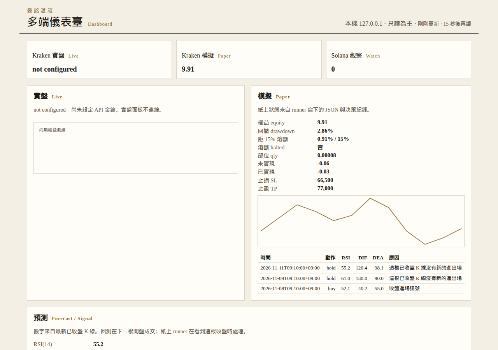
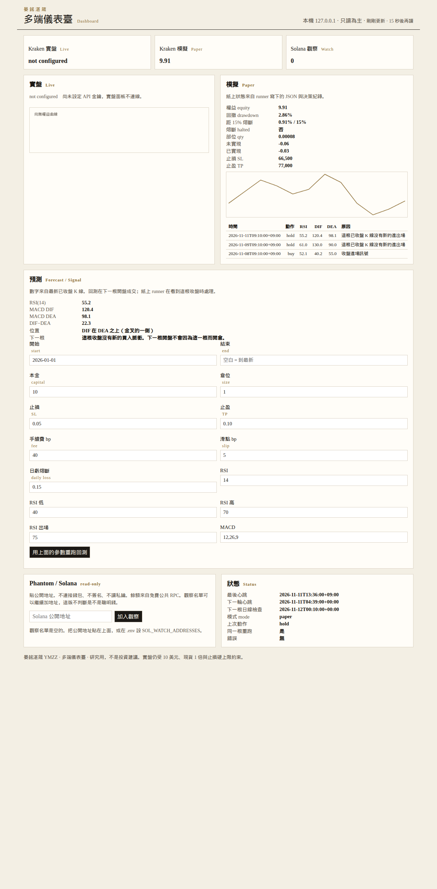

# 晏銘湛箴量化研究框架

多市場研究用的回測與紙上訊號。品牌是晏銘湛箴（YMZZ）。授權 MIT。

這版做三件事：用真實公開行情回測、把槓桿上限鎖在 2 倍、預留以後用自己的 Telegram 機器人發訊號。預設不下單、不收私鑰、不連接付費 API。實盤路徑要另外打開，而且本金、槓桿與止損有硬上限。

**入金與 API（請先看這份）：** [Kraken 入金與 API 設定教程](docs/kraken_入金與API設定教程.md)。晏銘要自己為已開通的 Kraken 帳戶入金約 10 美元，並建立給 `python -m ymzz.cli paper`／`--live` 用的 API 金鑰時，照那份做。金鑰不要貼進對話、Issue、截圖或 Git。

開源引擎與資料層怎麼取捨，見 [開源層級比較與取捨](docs/1111_1413_seoul_開源層級比較與取捨.md)。Nautilus 與 Lean 不放進這個倉庫。

## 安裝與執行

```bash
python -m venv .venv
source .venv/bin/activate
pip install -r requirements.txt
# 可選，不裝也不影響既有路徑：
# pip install -e ".[polymarket]"
# pip install -e ".[ccxt]"
PYTHONPATH=src pytest
PYTHONPATH=src python -m ymzz.examples
PYTHONPATH=src python -m ymzz.api
```

瀏覽器打開 <http://127.0.0.1:8765> 。介面、說明與報告用繁體中文。

自己跑回測，不必經過助理：

```bash
PYTHONPATH=src python -m ymzz.cli backtest \
  --strategy rsi_macd --source kraken --symbol BTC/USD --timeframe 1d \
  --start 2026-01-01 --end 2026-11-11 \
  --rsi 14 --rsi-low 40 --rsi-high 70 --rsi-exit 75 --macd 12,26,9 \
  --sl 0.05 --tp 0.10 --size 1.0 --capital 10 --fee-bp 40 --slip-bp 5 --daily-loss 0.15
```

會在 `results/` 寫出帳本 CSV 與 `MMDD_HHMM_seoul_*.md`（內文時間是首爾時間），並把同一份報告複製到 `docs/`。`--strategy` 也可以是 `macd`、`rsi_single`、`rsi_three`、`bollinger`、`ma_cross`、`grid`。來源只接受 `kraken` 或 `okx`；失敗就停，不會改接別的交易所。

紙上決策，適合 cron。同一根已收盤 K 線重跑不會再下單：

```bash
PYTHONPATH=src python -m ymzz.cli paper \
  --strategy rsi_macd --source kraken --symbol BTC/USD --timeframe 1d \
  --size 1.0 --capital 10 --sl 0.05 --tp 0.10 --daily-loss 0.15
```

```cron
10 0 * * * cd /path/to/ymzz && PYTHONPATH=src python -m ymzz.cli paper --strategy rsi_macd --source kraken --symbol BTC/USD --timeframe 1d --size 1.0 --capital 10 >> data/paper/cron.log 2>&1
```

狀態在 `data/paper/state.json`，決策會附加到旁邊的 CSV 與 Markdown。若本機有 `kraken` 執行檔（krakenfx/kraken-cli，MIT），紙上單交給 `kraken paper buy`／`sell`／`status`。沒有這個執行檔時，紙上單改在純 Python 裡用 Kraken 公開最後成交價成交，手續費與滑點沿用 `--fee-bp`、`--slip-bp`。實盤單仍然要 `kraken` 執行檔，不會用模擬成交代替。

`--live` 預設拒絕。要送實盤必須同時有環境變數 `KRAKEN_API_KEY`、`KRAKEN_API_SECRET` 和 `--i-confirm-live`。硬上限是本金不超過 10 美元、現貨 1 倍、買單一定附止損。程式不會印出密鑰。這份倉庫的測試沒有、也不會打實盤。入金、權限與交鑰步驟見 [Kraken 入金與 API 設定教程](docs/kraken_入金與API設定教程.md)。

紙上訊號機器人：

```bash
export TELEGRAM_BOT_TOKEN=你的權杖
PYTHONPATH=src python -m ymzz.telegram_bot
```

權杖只放環境變數。不要寫進檔案或提交。機器人只回覆訊號，沒有下單指令。GMGN 執行函式會直接拋出「尚未實作」。

## 安裝儀表板

多端儀表臺把 Kraken 實盤、Kraken 模擬、Solana 只讀觀察放在同一頁。預設只聽 `127.0.0.1:8787`。沒有 API 金鑰時，實盤區塊顯示 `not configured`，不會連線，也不會把密鑰印出來。





上面兩張是 2026-11-11 用本機紙上狀態打開的畫面。當時沒有填 API 金鑰，所以實盤是 `not configured`。Solana 觀察名單是空的。

### Windows

在倉庫根目錄的 PowerShell：

```powershell
powershell -ExecutionPolicy Bypass -File .\install.ps1
.\start.bat
```

瀏覽器打開 <http://127.0.0.1:8787/> 。`install.ps1` 會建立 `.venv`、安裝依賴，並在還沒有 `.env` 時從 `.env.example` 複製。`.env` 已在 `.gitignore`。金鑰只寫在 `.env` 的 `KRAKEN_API_KEY` 與 `KRAKEN_API_SECRET`，觀察地址寫在 `SOL_WATCH_ADDRESSES`（逗號分隔的公開地址）。`start.bat` 會另開視窗跑儀表臺，並在目前視窗跑紙上 runner。

### macOS 與 Linux 桌面

```bash
chmod +x install.sh start.sh
./install.sh
./start.sh
```

瀏覽器同樣打開 <http://127.0.0.1:8787/> 。關掉 `start.sh` 那個終端，儀表臺會一起停。想自己拆開跑：

```bash
PYTHONPATH=src python -m ymzz.cli dashboard --host 127.0.0.1 --port 8787
PYTHONPATH=src python -m ymzz.cli run --mode paper
```

安裝成套件之後也可以用 `ymzz dashboard` 與 `ymzz run --mode paper`。只跑一輪決策（給測試或 cron）：`python -m ymzz.cli run --mode paper --once`。同一台機器上第二個 runner 會直接退出。

實盤迴圈仍要金鑰與確認旗標，硬上限不變（本金不超過 10 美元、現貨 1 倍、買單附止損）：

```bash
PYTHONPATH=src python -m ymzz.cli run --mode live --i-confirm-live
```

### Linux 伺服器

單元檔在 `deploy/systemd/ymzz-dashboard.service` 與 `deploy/systemd/ymzz-runner.service`。範例路徑是 `/opt/ymzz`。服務預設紙上模式，儀表臺只綁 `127.0.0.1`。

```bash
sudo mkdir -p /opt/ymzz
sudo rsync -a --exclude .venv ./ /opt/ymzz/
cd /opt/ymzz
./install.sh
# 編輯 /opt/ymzz/.env，不要把金鑰提交
sudo cp deploy/systemd/ymzz-dashboard.service deploy/systemd/ymzz-runner.service /etc/systemd/system/
# 若目錄不是 /opt/ymzz，改 WorkingDirectory、ExecStart，並加上 User=你的帳號
sudo systemctl daemon-reload
sudo systemctl enable --now ymzz-dashboard.service ymzz-runner.service
```

在自己的電腦上看畫面：

```bash
ssh -L 8787:127.0.0.1:8787 user@server
```

然後打開 <http://127.0.0.1:8787/> 。不要把儀表臺改綁到公開網址；這個程式沒有登入。

## 策略

使用者選擇策略與參數。每條策略最多三個決策指標。訊號在收盤確定，下一根開盤才成交。

| 編號 | 決策指標 | 規則 |
| --- | --- | --- |
| `rsi_single` | 一條 RSI | 上穿超賣線做多，下穿超買線平倉。預設 14／30／70。Wilder 1978。 |
| `rsi_three` | 短、中、長 RSI | 預設 6／12／24，可改成例如 14／19／24。觸發線永遠是「短週期」欄位：短線上穿中線且短線高於長線才做多；短線下穿中線就平倉。程式不把三個數字重新排序。 |
| `macd` | DIF、DEA | DIF 上穿 DEA 做多，下穿平倉。柱狀圖只顯示。預設 12／26／9。 |
| `bollinger` | 下軌、中軌 | 收盤跌破下軌做多，站回中軌平倉。上軌只畫圖。標準差是母體。 |
| `ma_cross` | 快均線、慢均線 | 預設 5 與 20。金叉做多，死叉平倉。 |
| `grid` | 價格對格線 | 等差格。沒填上下界時，用第一根收盤 ± 幅度固定，不用全樣本高低點。 |
| `rsi_macd` | RSI、DIF、DEA | 收盤出現 MACD 金叉，而且 RSI(14) 在 40 到 70，才在下一根開盤做多。出場看誰先到：止損 5%、止盈 10%、MACD 死叉，或 RSI 收盤大於 75。死叉和 RSI 出場用該根收盤價。同一根同時碰到止盈和止損時先止損。週期和門檻都可以改。柱狀圖只顯示，不參與決策。 |

現貨遇上空頭訊號會改成平倉。永續要做空必須另勾「允許做空」。布林回歸與網格這版不做空。

## 槓桿、費用、出場

槓桿只接受 1、1.5、2。後端再檢查一次。現貨（含 A 股、池子、預測市場）大於 1 直接拒絕，不會把現貨報酬乘上倍數。

大於 1 只存在「加密永續」模式：用該交易所的永續 K 線和資金費。保證金是帳戶裡的錢，虧損不會追加。觸及維持保證金就清算；開盤跳空穿過破產價則權益歸零。預設維持保證金率 0.4%，這是參數，不是即時抓到的階梯表。資金費以該根收盤價當計價，並在報告裡寫明。日內先被止損打出的部位，該根不再扣資金費。

其他成交假設：

- 手續費、固定滑點（bp），以及可選的量能衝擊。沒有成交額又打開量能衝擊時，回測停止，不會自己估一個量。
- 止盈與止損都設在成交價上。開盤價若已在兩側之間，而這根高低點兩邊都碰到，先止損。
- 開盤已經跳空穿過某一側，用開盤價。
- A 股一手 100 股。買進那一根不能賣，這是日線上的 T+1；這版沒有把昨倉和今倉拆帳，當天若加倉，整筆都鎖到下一根。賣出另計印花稅，預設 5bp。漲停價不成交買單，跌停價不成交賣單，止損也一樣。幅度用前收：ST 5%，主板 10%，創業板（300、301）與科創板（688、689）20%。K 線標成停牌就不成交。來源沒有停牌旗標時，不會把成交量 0 猜成停牌。
- 未平倉用最後收盤做市值，帳本上仍是持倉。

加密預設本金 10 美元。貴州茅台一手遠高於這個數字，A 股預設 20 萬元；不夠一手就停止，不拆零股。

另外可以設倉位比例（預設 1，也就是 10 美元全用上）、UTC 日虧熔斷（預設一天虧掉日初權益的 15% 就不再開新倉；新的 UTC 日會清掉這個限制，所以日線的下一筆進場通常落在新的一天），以及交易所最小下單量。Kraken 的最小幣數與最小名義向公開 `AssetPairs` 讀取，這次是 0.00006 BTC 與 0.5 USD。低於下限的單記成 `below minimum`，不算成交。10 美元的 30% 在比特幣現價買不起這個最小量。其他交易所沒有查到最小量時，報告會寫明這次沒有套用，不會拿 Kraken 的數字去套 OKX。

## 資料

每個來源失敗都會帶著 HTTP 狀態停下，不會改問下一個。快取記下網址、UTC、首爾時間與 sha256。即時模式失敗時不讀舊快取充數。未收盤 K 線會剔除。

| 市場 | 來源 | 說明 |
| --- | --- | --- |
| A 股日線 | 新浪、騰訊前復權、東財 `fqt=1` | 只有日線。新浪沒有復權參數，不稱作前復權。騰訊與東財的量是手，程式乘 100 成股。東財主機要明示，預設 `80.push2his.eastmoney.com`，不會輪詢。 |
| BTC 現貨 | OKX、幣安、Kraken `BTC/USD`，另有可選 ccxt | OKX 日線切在 UTC+8。幣安與 Kraken 切在 UTC。Kraken 公開 OHLC 大約 720 根，未收盤與 `last` 之後的 K 線會剔除。不要混著比訊號。ccxt 要另裝，並在請求帶 `ccxt_exchange`，不會改走那三個既有解析。 |
| BTC 永續 | OKX、幣安 | 必須同時拿到資金費，而且幣安會帶 `startTime`／`endTime` 逐頁補齊。Kraken 這版沒有永續。ccxt 不接永續。 |
| Solana 池 | GeckoTerminal 日線與 15 分 | 熱門池有生存者偏差。預設 30bp 是假設的池費。 |
| Polymarket | 預設 Gamma + CLOB `prices-history` | 用 token id。歷史是價格點。HTTP 451 或空陣列就停止，不用現價編歷史。`adapter=sdk` 會試官方 `polymarket-client`（MIT，beta）；沒裝就退回 httpx。 |
| Stock App 打金狗 | 無 | 產品還沒被指認。不接 yfinance，也不用 A 股或 GMGN 頂替。 |

公開端點有頻率限制。幣安看 weight，OKX、Gecko、Solana 公共 RPC 都容易被限流。程式每次請求至少隔 0.25 秒（Solana 路徑 0.4 秒）。慢可以，假資料不行。

## 錢包與跟單

輸入別人的公開地址。程式用 Solana 公共 RPC 讀簽名與 `jsonParsed` 交易，把兌換、轉帳、包裝、失敗分開。轉帳不是損益。跟單回測只重播兌換：延遲之後的下一根 K 線開盤，再加滑點；錢不夠就縮小，不加槓桿。沒有 K 線就拒絕，不會用對方的成交價假裝延遲後的市價。

看不出地址是不是聰明錢，也看不出代幣之後賣不賣得掉。

## 授權邊界

見 [NOTICE.md](NOTICE.md) 與 [開源層級比較](docs/1111_1413_seoul_開源層級比較與取捨.md)。可以依賴的 MIT 專案包含 ccxt、akshare、pandas-ta-classic、ta、aiogram、solana-py、Polymarket py-sdk（PyPI 套件名 `polymarket-client`）。預設安裝並呼叫的是 aiogram。ccxt 與 polymarket-client 是可選額外依賴，沒裝就用既有 HTTP。週期類參數必須是整數，14.9 不會被截成 14。止盈或止損之後，若目標曝險沒變，預設要等訊號改向才再進場。

freqtrade、backtesting.py、vectorbt、python-telegram-bot 只可當對照，原始碼沒有進這個倉庫。

## 2026-11-11 的 Kraken 日線重跑

規則事先固定：RSI+MACD、倉位 100%、本金 10 美元、手續費 40 bp、滑點 5 bp、止損 5%、止盈 10%、日虧熔斷 15%。雲端在 2026-11-11 10:32 KST 用 Kraken 公開 OHLC 與 AssetPairs 重跑 2026-01-01 至最新已收盤日線，314 根。

5 筆來回，勝率 40%，期末 **11.0269** 美元（四捨五入就是先前報告的 11.03），報酬 **+10.27%**，最大回撤 **5.36%**，樣本期買入持有 **-16.53%**。五筆的成交價與先前核准明細相同。完整表在 `docs/1111_1032_seoul_rsi_macd_kraken_1d.md`。

5 筆什麼都證明不了。同一份核准紀錄裡，4 小時與 1 小時全部虧錢，不建議拿 10 美元去模擬那些週期。這不是投資建議。回測用下一根開盤加固定滑點，沒有排隊、沒有部分成交。

## 測試

`PYTHONPATH=src pytest` 含槓桿上限、清算、手續費與滑點、止盈止損順序、RSI 週期改變數值、RSI+MACD 的進場區間與最小下單量、紙上決策的冪等與實盤拒絕、錄製下來的來源樣本，以及錢包分類。真實網路的範例是 `python -m ymzz.examples` 與上面的 `python -m ymzz.cli backtest`。

## English

YMZZ is an MIT-licensed research framework. Pick a strategy, run a backtest on public candles, or let cron take one paper decision on the latest closed candle. Live orders stay off unless both Kraken environment variables are set and `--i-confirm-live` is passed; capital then cannot exceed 10 USD, and the only allowed order is spot with 1x leverage and a stop attached. The Kraken daily RSI+MACD rerun on 2026-11-11 made 5 trades, won 40%, and turned 10 USD into 11.03 USD (+10.27%, max drawdown 5.36%) against a buy-and-hold of -16.53%. Five trades prove nothing, and the 4h and 1h variants lost money. This is not investment advice.
