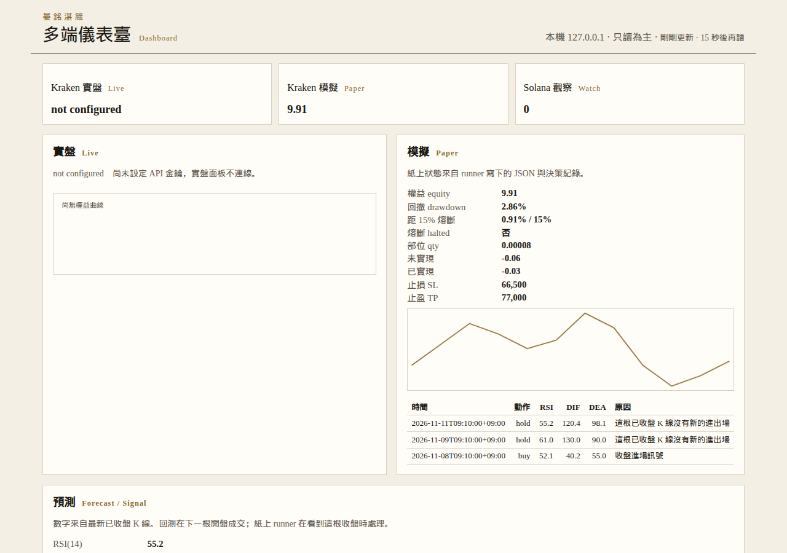

# Kraken 入金與 API 設定教程

English summary. YanMing already has a Kraken account. This page is the checklist he follows himself to deposit about 10 USD and to create one API key for `python -m ymzz.cli paper` and, later, `--live`. Every click below is taken from a Kraken support or docs page, and each step cites that page. Where a button label could not be read from those pages, the text says so and links the official guide. It does not decide whether a mainland China passport, Wise, or PayPal can fund this account. Kraken's own geographic-restrictions article is the page to check, because eligibility follows verified residence and the list changes. The strategy in this repo trades Kraken spot XBT/USD, so the balance it can use is USD. Public `AssetPairs` on 2026-11-11 shows `XBT/USDC` is online, but this CLI accepts only `BTC/USD` or `XBT/USD` on the Kraken paper and live path. The API key may query funds, query open and closed orders and trades, create and modify orders, and cancel or close orders. Withdraw Funds stays off. The secret goes only into `KRAKEN_API_KEY` and `KRAKEN_API_SECRET`, never into chat, GitHub, an issue, a commit, or a screenshot. Run paper for a while before any live order. Live also requires `--live --i-confirm-live`, and the program refuses capital above 10 USD, leverage other than spot 1x, and a buy without a stop. A five-trade backtest is not evidence of an edge.

Written: 2026-11-11 13:36 KST

這份是給晏銘自己操作的入門步驟。帳戶已經開好。目標是入金大約 10 美元，並做出一把只給本倉庫 `ymzz.cli` 使用的 API 金鑰。金鑰的公鑰與私鑰只出現一次。看到金鑰畫面時，不要截圖，不要貼到對話、GitHub、Issue 或任何檔案再提交。

下面每個步驟後面都有官方網址。畫面上的字和這裡寫的不一樣時，以你登入後的畫面和該網址為準。本教程沒有替 Kraken 發明按鈕名稱。

## 1. 先看地理限制，再決定能不能入金

Kraken 寫明：能不能使用服務，看的是**已驗證的居住地**，不是護照國籍。限制可以落到「哪些資產可以買、賣、存入」。資金供應商也可以自行拒絕某些地區。

請自己打開並讀完這一頁，再做入金：

- 英文：<https://support.kraken.com/articles/where-is-kraken-licensed-or-regulated>（頁面標示 Last updated: November 4, 2026）
- 中文介面同一篇：<https://support.kraken.com/cn/articles/where-is-kraken-licensed-or-regulated>

2026-11-11 讀到的英文頁，禁止提供服務（不能存入現金或加密貨幣）的地區是：Afghanistan、Belarus、烏克蘭的 Crimea／Donetsk／Luhansk、Cuba、Democratic Republic of the Congo、Iran、Iraq、Japan、Libya、North Korea、Russia、Sudan、South Sudan、Syria。那一版清單裡沒有寫出中國或 People's Republic of China。這只是該頁當天的文字，**不是**「持有中國大陸護照就可以入金」的結論。居住地、驗證等級、資金管道都會再過濾一次。清單會改，以你打開時的頁面為準。

同一頁還寫了幾件和入金方式有關的限制，請對着自己的驗證居住地看，不要套用別人的帳戶：

- 部分地區不能用簽帳金融卡或信用卡。該頁要你再去讀 Kraken 的卡片常見問題。本教程沒有另開那篇的網址，卡片能不能用請從限制頁上的連結進去看。
- 歐洲經濟區（EEA）客戶不能存入或交易 USDT。若你的驗證居住地在 EEA，不要走 USDT。
- 美國居民有另一份限制資產清單。你的居住地若不是美國，就不要用下面「僅限美國」的法幣管道。

你有 Wise 和 PayPal。2026-11-11 核對過的現金入金表（下一節的網址）**沒有出現 Wise 這個名字**。PayPal 的美元列被標成 **USA only**。有 PayPal 帳戶不夠。是否可用，只看你登入後 Deposit 畫面實際列出的方式。

## 2. 驗證等級：入金和交易要先通過一般驗證

官方說明：

- 驗證等級（Last updated: October 6, 2026）：<https://support.kraken.com/articles/360001395743-verification-levels-explained>
- kraken.com 怎麼送件：<https://support.kraken.com/articles/360021973671-how-to-get-verified-on-kraken>
- Kraken Pro 怎麼送件，以及在哪裡看狀態：<https://support.kraken.com/gb/articles/7352481747220-how-to-get-verified-on-kraken>
- 更高限額的入口：<https://support.kraken.com/gb/articles/personal-account-with-higher-limits>（人像圖示 → Settings → Account details 區塊 → **Get higher limits**）

驗證等級說明頁寫：已驗證的個人帳戶可以買賣加密貨幣，也可以存入現金和加密貨幣。同一頁寫，在 Kraken Pro 查看狀態的位置是 **Settings > Account > Account details**。Kraken Pro 的驗證教學把同一件事寫成：右上角姓名或人像圖示 → **Settings**，畫面上會標出目前是 pending 或 verified。兩篇的層級名稱都以你登入後看到的為準。

一般驗證就能產生 API 金鑰。驗證說明頁的表把現金存提月限額寫成低於 100,000 美元，API 金鑰上限寫成 16 把；更高限額那一欄是月限額高於 100,000 美元、API 金鑰上限 25 把。另一篇「能產生幾把金鑰」（Last updated: October 6, 2026）把 Standard verification 寫成 16 把、Verified with higher limits 寫成 75 把：<https://support.kraken.com/articles/360001163666-how-many-api-keys-can-i-generate->。兩篇對更高限額的把數不一致。這次只用一把，停在一般驗證即可，不必為了對上 25 或 75 去升級。

大約 10 美元用不到更高限額。驗證說明頁寫：使用 Kraken Pro 網頁或 App 不需要更高限額。

送件畫面會隨地區改變。kraken.com 那篇寫到的步驟是：登入，在首頁按 **Verify identity**，填資料，從下拉選國家，再選證件類型並上傳。Kraken Pro 那篇寫的是右上角 **Verify your identity**。你在哪一套介面，就按那一篇的按鈕。兩篇都說，通過驗證之後才能入金和交易。證件種類在送件流程裡的 **Document requirements**。本教程沒有逐項核對那份子清單，所以不寫中國大陸護照是否被接受。被要求補件時，照你畫面上的 Document requirements 做。

驗證說明頁在 2026-11-11 仍掛着一句：新帳戶處理有延遲。你的帳戶若還卡在 pending，以該頁和你自己的狀態為準，不要重複送另一條沒有出現在畫面上的流程。

## 3. 入金大約 10 美元

策略交易的是 Kraken 現貨 **XBT/USD**（也寫成 BTC/USD）。帳戶裡要有 **USD**，程式才買得到這一對。只有 USDC 或 USDT 時，要先在 Kraken 換成 USD，或接受下面第 3.4 節的限制：這支 CLI 目前不能把交易對改成 BTC/USDC。

10 美元很小，手續費和最低額會吃掉可觀的一部分。下面的數字都來自 2026-11-11 讀到的官方頁，之後以你登入後的入金頁為準。

### 3.1 法幣：官方表上和「約 10 美元」有關的列

現金入金選項、費用、最低額與到帳時間：

<https://support.kraken.com/articles/360000381846-cash-deposit-options-fees-minimums-and-processing-times->

美元入金總覽（含 PayPal 姓名必須與 Kraken 法定姓名一致、帳戶須已驗證）：

<https://support.kraken.com/articles/usd-funding-guide>

該表在 2026-11-11 的美元區塊是：

| 表上的適用範圍 | 方式 | 最低入金 | Kraken 收取的入金費 | 到帳 | 出金凍結 |
| --- | --- | --- | --- | --- | --- |
| USA only | ACH (Plaid) | 1 USD | Free | Near-instant | 7 天 |
| USA only | PayPal | 1 USD | Processing fees，費率依地區，在最後確認頁才顯示 | Near-instant | 72 小時 |
| USA only | Debit card | 10 USD | $0.25 + 3.75% | Near-instant | 72 小時（該表註記：並非每筆卡入金都凍結） |
| USA only（供應商可能再限地區） | FedWire (Dart Bank) | 1 USD | Free | 0–1 個營業日 | 無 |
| Worldwide（供應商可能再限地區） | SWIFT (Customers Bank) | 100 USD | Free | 1–3 個營業日 | 無 |
| Worldwide（供應商可能再限地區） | SWIFT (Bank Frick) | 4 USD | 3 USD | 1–5 個營業日 | 無 |

表下的註記：PayPal 費用不固定，只在確認頁顯示。本教程因此不寫 PayPal 的百分比。FedWire 與兩條 SWIFT 都註明供應商可能只開放部分地區，並要你回到地理限制頁。Bank Frick 那一列另註：費用可能隨註冊時的居住國改變。美元入金指南寫 FedWire 只給美國客戶、且匯出銀行也在美國，戶名必須一致；它建議匯款至少 30 美元，以免銀行手續費把金額吃小。Kraken 自己對 FedWire 入金標的是 Free。

和大約 10 美元直接相關的費用：

- 簽帳金融卡最低就是 10 美元，表上費用是 0.25 + 10 × 3.75% = 0.625 美元，而且這一列是 USA only。
- SWIFT (Bank Frick) 最低 4 美元，Kraken 入金費 3 美元。匯 10 美元時，這一筆 3 美元就是三成，匯出銀行還可能另收費。
- SWIFT (Customers Bank) 最低 100 美元，高於這次的金額。
- Wise 沒有出現在這張表或美元入金指南裡。不要假設 Wise 餘額可以當 Kraken 的入金方式。

法幣入金的點擊，兩套介面官方寫法不同。你在哪一套，就只跟那一篇：

- kraken.com：<https://support.kraken.com/articles/how-do-i-deposit-my-local-currency-to-kraken-web>。登入後按 Deposit，或左側 Transfer／asset／portfolio 分頁，搜尋貨幣（該文例子是 USD），在 Deposit method 裡選 Manual bank transfer 或 Easy bank transfer。這些選項是否出現，取決於你的帳戶。
- Kraken Pro：<https://support.kraken.com/articles/6528061586708-how-do-i-deposit-my-local-currency-to-kraken->。搜尋貨幣後，Method 可能列出 Linked bank transfer、Easy bank transfer 或 Manual bank transfer（該文點名 USD／EUR／GBP）。沒有列出的方式就不要做。

### 3.2 加密貨幣入金：網路選錯會直接損失

先確認帳戶已驗證。Kraken Pro 的入金步驟（Last updated: October 7, 2026）：

<https://support.kraken.com/articles/7078582415636-how-to-deposit-cryptocurrencies-to-your-kraken-account>

1. 登入，進入 **Portfolio**。
2. 按 **Deposit**。
3. 搜尋要存入的幣並點選。
4. 用複製圖示複製地址，貼到轉出錢包。不要手打。該文列出需要額外欄位的是 XRP（destination tag）、XLM（memo，除非用 muxed address）、STX（memo）、EOS（memo）。USDC／USDT 不在這份名單裡；若你的入金頁另外要求 memo 或 tag，照該頁填，本教程不替 USDC 發明一個 memo。
5. 達到該幣要求的確認數後才入帳。處理時間表：<https://support.kraken.com/articles/360000292886-cryptocurrency-deposit-fees-and-minimums> 頁內指向的 processing times（以入金頁連結為準）。

地址沒有自動出現時，Kraken Pro 另一篇寫：按 **Generate deposit address**，等幾秒。

<https://support.kraken.com/articles/7432313905172-generating-new-deposit-addresses>

kraken.com（不是 Pro）的步驟多了明確的選網：Deposit，或左側 **Transfer** 再 **Deposit**，選幣，**Choose your network**，第一次存該幣時按 **Generate deposit address**，再用複製圖示複製。

<https://support.kraken.com/articles/360000672643-how-to-deposit-cryptocurrencies-to-your-kraken-account>（Last updated: August 19, 2026）

Pro 那篇的編號步驟沒有單獨寫出 “Choose your network” 這個按鈕，但同一篇寫了：有些幣可以走多條網路；走 PrivateSend、CoinJoin 或其他混淆工具的入金不會入帳，而且可能損失；必須使用 Kraken 支援的網路和幣，否則資金會損失。選網時只選你這次入金頁上列出來、且和轉出錢包一致的那一條。

USDC 在 Polygon 與 Arbitrum 上各有 USDC.e 和 native USDC。轉出錢包用哪一種，入金頁就要選哪一種。

<https://support.kraken.com/articles/360000292886-cryptocurrency-deposit-fees-and-minimums>（該頁註記，Last updated: September 3, 2026）

### 3.3 加密貨幣的最低額與手續費

同一篇入金費用頁寫：

- 加密貨幣入金本身是免費的（Free）。少數幣另有 address setup fee 或 deposit fee。USDC／USDT 有沒有這類費用，以你打開該幣入金頁時的文字為準。本教程沒有從公開頁面可靠抽出「每一條 USDC／USDT 網路的入金最低額」表格，那些數字會改，而且該頁要你登入後看該幣入金頁上的最新數字。不要用搜尋引擎摘要裡的最低額。
- 該頁同時把提現網路的 fee／min amount 和入金說明放在同一篇的資料裡。提現最低額不是入金最低額。入金以入金頁寫的 Deposit minimum 為準。
- 轉出金額必須在扣掉**轉出鏈的網路費**之後，仍高於 Kraken 的入金最低額。低於最低額的入金會被標成 Failed，資金永久損失。之後再補一筆達標的入金，也不會把先前那筆失敗的補回來。

10 美元特別容易死在這裡。以太坊網路上，轉帳的網路費可能接近甚至超過 10 美元。請在 Kraken 入金頁比較它列出的網路，選最低額低、而且轉出錢包手續費也低的那一條。哪一條最便宜，以你當天的入金頁和轉出錢包報價為準，本教程不指定一條。

入金到帳後還有交易最低額，這是另一個數字：

<https://support.kraken.com/articles/360001389303-overview-of-cryptocurrency-minimums>

該頁寫美元訂單最低額是 5 USD（存款最低額則看存款方式，和訂單最低額不是同一個數）。

### 3.4 換成策略要用的 USD，以及 CLI 不接受 BTC/USDC

2026-11-11 查詢公開介面：

`https://api.kraken.com/0/public/AssetPairs?pair=XBTUSD`

回傳 `XBT/USD`（內部名 `XXBTZUSD`）status `online`，`ordermin` `0.00006`，`costmin` `0.5`。

同一天另外查到、而且 status 為 `online` 的相關交易對：

| wsname | ordermin | costmin |
| --- | --- | --- |
| XBT/USD | 0.00006 | 0.5 |
| XBT/USDC | 0.00006 | 0.5 |
| USDC/USD | 5 | 0.5 |
| USDT/USD | 5 | 0.5 |
| XBT/USDT | 0.00006 | 0.5 |

交易對是否在你的居住地開放，Kraken 在市場清單上另有限制：

<https://support.kraken.com/articles/kraken-markets>（Last updated: October 30, 2026）

本倉庫的程式目前只接受 BTC/USD。`src/ymzz/paper.py` 的 `kraken_pair()` 只放行 `BTCUSD`／`XBTUSD`。`python -m ymzz.cli backtest --source kraken` 也只接受 `BTC/USD` 或 `XBT/USD`。紙上與實盤載入 K 線時使用的就是 BTC/USD。因此：

- 帳戶裡需要 USD，再由程式去交易 XBT/USD。
- 你若只持有 USDC，**不要**把命令改成 `--symbol BTC/USDC`。公開 API 看得到 `XBT/USDC`，這支 CLI 仍會拒絕。
- 持有 USDC 時，在 Kraken 把 USDC 賣成 USD。`USDC/USD` 的 `ordermin` 在 2026-11-11 是 5，大約 10 USDC 高於這個數量下限，`costmin` 是 0.5。是否能下這張單，仍看你的帳戶是否看得到該交易對，以及 5 美元的現金訂單最低額。
- Kraken Pro 賣出步驟：<https://support.kraken.com/articles/how-to-buy-and-sell-on-kraken-pro>。在 Trade 分頁左上角的市場選擇器選交易對（該文的例子是 BTC/USD；賣 USDC 時選 USDC/USD，若你的清單裡沒有這一對，就停在官方市場頁，不要改走別的幣）。Sell 是賣出基礎貨幣、收到報價貨幣。市價單只填數量，按該文說的大顆買賣按鈕送出。市價單一定收 taker 費。
- App 的 Convert：<https://support.kraken.com/articles/360058727972-buying-selling-and-converting-cryptocurrency-with-the-kraken-app>。該文寫 Convert 的現金會進你在 App 裡設定的預設法幣。要收到 USD，就先把預設法幣改成 USD。本教程沒有核對「改預設法幣」的按鈕文字，改法幣時見該篇與帳戶設定。

穩定幣換成法幣也要付交易費。10 美元上，這一趟轉換和後面策略的進出場是疊加的。

### 3.5 10 美元上的交易費

現貨費率表（Last updated: October 30, 2026）：

<https://support.kraken.com/articles/cross-platform-fee-tier-changes>

第一級（30 日現貨成交量 $0+）是 maker **0.40%**、taker **0.80%**。

市價單，以及觸發後以市價成交的止損，收的是 taker 費：

<https://support.kraken.com/articles/360000526126-what-are-maker-and-taker-fees->

本倉庫回測預設 `--fee-bp 40`，是單邊 0.40%。這和上面第一級的 **maker** 相同，和第一級 **taker 0.80%** 不同。實盤這條路徑下的是市價買單，再掛一張止損賣單。止損一旦成交，進出兩邊都可能按 0.80% 計。10 美元來回大約是 0.16 美元的 taker 費，再加程式預設單邊 5 bp 的滑點假設。請以你帳戶畫面上的費率為準。

## 4. 建立 API 金鑰

金鑰教學（Last updated: October 29, 2026）：

<https://support.kraken.com/articles/how-to-create-an-api-key-on-kraken-pro>

權限對照（docs.kraken.com）：

<https://docs.kraken.com/exchange/guides/rest/api-keys>

### 4.1 官方寫明的點擊

在 **Kraken Pro** 登入後：

1. 打開帳戶選單（頁面右上角的人像圖示）。
2. 選 **Settings**。
3. 打開 **API** 分頁，按 **Create API key**。
4. **Key Name** 填唯一名稱。請用 `ymzz_quant`。官方例子是 “Trading Key”、“Python API Key 6” 這類用途說明，不要把帳戶號碼或秘密寫進名稱。
5. 只勾下面第 4.2 節的權限。
6. 按 **Generate key**。

docs.kraken.com 的 Quickstart 把同一個入口寫成 Settings → API → **Add key**：

<https://docs.kraken.com/home/guides/quickstart>

你的畫面若是 Add key 而不是 Create API key，按畫面上那一個，兩篇指的都是 Settings → API。

公鑰、私鑰和 QR code 只顯示這一次。官方要求存進密碼管理器，並且不要以未加密的形式保存。離開頁面後無法再把私鑰顯示出來。編輯權限也不會重新顯示私鑰。

<https://support.kraken.com/articles/360001163666-how-many-api-keys-can-i-generate->

### 4.2 這支程式要的權限

`ymzz.cli paper --live` 會查餘額、下市價買單、並附上一張止損賣單。紙上單本身走本機 `kraken paper`，不使用這把金鑰；金鑰是給之後的實盤。權限照實盤會用到的範圍開，並加上查已結委託，方便你自己對帳。

支援頁把「下單與改單」寫成 **Modify Orders**，說明裡包含 AddOrder、EditOrder、AddOrderBatch。docs.kraken.com 把同一組寫成 **Create & Modify Orders**，Add Order 文件寫的權限字是 `Orders and trades - Create & modify orders`。畫面上兩種寫法出現哪一種，就勾那一個。不要兩個都找不到時去勾 Withdraw。

請開啟：

- **Query Funds**（餘額、TradeBalance）
- **Query Open Orders & Trades**
- **Query Closed Orders & Trades**
- **Modify Orders**，或畫面上的 **Create & Modify Orders**
- **Cancel/Close Orders**

請保持關閉：

- **Withdraw Funds**。這是硬性要求。關閉提現後，金鑰即使外洩也不能把幣轉走。
- **Deposit Funds**。這支 CLI 不建立入金地址。
- **Query Ledger Entries** 與 **Export Data**。對帳用不到匯出。
- Earn，以及任何提現地址權限。

docs.kraken.com 對「演算法現貨」列出的是 Query Funds、Query Open Orders & Trades、Create & Modify Orders、Cancel/Close Orders。本教程在此之外多開 Query Closed Orders & Trades，因為你要能事後查已結成交。多開的是查詢，不是提現。

### 4.3 其他欄位

- **IP Address Restriction**：官方的名稱是這個。docs 的 Quickstart 建議正式使用時把金鑰限制在特定 IP。你的下單機器有固定公網 IP 時，填那一個 IP。家用網路或雲端助理的 IP 經常變，填錯之後所有呼叫都會失敗，而且你人在別處時改不了。不確定就留空，靠「不能提現」和單獨一把金鑰來限制損害。本教程不替這個欄位發明輸入格式，照該頁的說明填。
- **Custom Nonce Window**：預設是 0，請維持 0。只有出現 `EAPI:Invalid nonce`、而且原因是請求順序錯亂時才加大。說明：<https://support.kraken.com/articles/360001148023-what-is-a-nonce-window->。第三方服務那篇寫，異常大的 nonce window 會造成錯誤，錯誤太多時金鑰可能要刪掉重建：<https://support.kraken.com/articles/360041395271-using-the-kraken-api-with-a-third-party-service>。
- **WebSocket interface**、**Key Expiration**、**Query Start/End Date/Time**：這支 CLI 都不用。WebSocket 保持關閉。到期日與查詢日期留在預設（不額外限制），避免金鑰在你還沒注意到時失效。
- **API 金鑰 2FA**：安全文建議在客戶端支援時開啟：<https://support.kraken.com/articles/api-key-security>。同一篇也說，開啟後客戶端每次都要送出 2FA，否則呼叫失敗。本倉庫的實盤命令沒有附帶 2FA 欄位。Get API Key Info 文件也寫，只有金鑰設定了 2FA 時才需要 `otp`：<https://docs.kraken.com/api-reference/account-data/get-api-key-info>。因此這把 `ymzz_quant` **不要開 API 金鑰 2FA**。登入帳戶用的 2FA 是另一件事，維持開啟；登入 2FA 的按鈕本教程沒有逐項核對，請用帳戶安全頁自己的說明。

## 5. 把金鑰交給程式，以及如何作廢

私鑰出現後：

- 存進密碼管理器。
- 不要貼進和助理的對話、GitHub、Issue、Commit、Pull Request 或截圖。
- 助理若提供專門填環境變數的密鑰欄位，只在那個欄位填入 `KRAKEN_API_KEY` 與 `KRAKEN_API_SECRET`。本教程沒有核對 Cursor 或任何助理畫面上的按鈕名稱。沒有那種欄位時，就不要把金鑰交給對話。

本機使用時，只放環境變數。程式讀的是環境變數，不會自動載入 `.env`：

```bash
export KRAKEN_API_KEY='公鑰'
export KRAKEN_API_SECRET='私鑰'
```

若你把這兩行寫進專案根目錄的 `.env`，使用前要自己載入，例如 `set -a && source .env && set +a`。本倉庫 `.gitignore` 已有一行 `.env`，`git check-ignore -v .env` 會指向該行。不要把 `.env` 改名成會被提交的檔案，也不要執行 `git add -f .env`。

`python -m ymzz.cli paper` 不加 `--live` 時，呼叫的是本機 `kraken paper buy`／`kraken paper sell`／`kraken paper status`，不用這把金鑰，也不會動用你入金的 10 美元。加上 `--live` 之後，子程序是 `kraken order buy` 與 `kraken order sell`，會繼承你當下的環境變數。kraken-cli 讀取 `KRAKEN_API_KEY` 與 `KRAKEN_API_SECRET`。

作廢或輪替：官方寫金鑰可以隨時建立、編輯、刪除，但私鑰不能找回。管理位置是 Kraken Pro 的 Settings → API。第三方服務那篇寫的作法是刪掉舊金鑰，再產生一對新的。本教程沒有在官方文章裡讀到刪除按鈕的確切英文標籤，請在 API 分頁對照畫面，見：

- <https://support.kraken.com/articles/360001163666-how-many-api-keys-can-i-generate->
- <https://support.kraken.com/articles/360041395271-using-the-kraken-api-with-a-third-party-service>
- 金鑰失效或被停用時的錯誤說明也指向 Settings → API：<https://support.kraken.com/articles/360001491786-api-error-messages>

Organizations 文件裡的 Manage API Keys 審批流程是機構帳戶的，不是個人帳戶這把金鑰的刪除方式。輪替時：在 API 分頁刪除 `ymzz_quant`，重新 Generate 一把，只把新的私鑰放進環境變數，舊的環境變數作廢。

## 6. 設定完成後怎麼跑

先紙上，跑過一段時間，確認日誌裡的方向和止損價你自己看得懂，再考慮實盤。紙上命令：

```bash
PYTHONPATH=src python -m ymzz.cli paper \
  --strategy rsi_macd --source kraken --symbol BTC/USD --timeframe 1d \
  --size 1.0 --capital 10 --sl 0.05 --tp 0.10 --daily-loss 0.15
```

實盤必須兩個開關一起出現，而且環境變數已經設好。少一個就會拒絕：

```bash
PYTHONPATH=src python -m ymzz.cli paper \
  --strategy rsi_macd --source kraken --symbol BTC/USD --timeframe 1d \
  --size 1.0 --capital 10 --sl 0.05 --tp 0.10 --daily-loss 0.15 \
  --live --i-confirm-live
```

硬上限是程式裡的，不是 Kraken 後台的設定：

- `--capital` 大於 10 會拒絕。
- 實盤只有現貨 1 倍。沒有槓桿開關可開。
- 實盤買單若沒有止損價會拒絕。命令會先送 `kraken order buy BTCUSD <數量> --type market`，再送 `kraken order sell BTCUSD <數量> --type stop-loss --price <止損價>`。
- `--daily-loss 0.15` 用 UTC 日初權益。當日已實現虧損達到日初權益的 15% 後，當天不再開新倉。日線週期上，下一個 UTC 日開始時這個鎖會在下一根開盤成交前清掉，所以它很少擋到「隔日那一根」的單。它擋的是同一 UTC 日內的後續進場。
- `--size 1.0` 是 100% 權益。這不是建議加碼，是因為 Kraken 的最小下單量大於 10 美元的 30%。

2026-11-11 的公開 `AssetPairs`：XBT/USD `ordermin` 0.00006 BTC，`costmin` 0.5 USD。同一天回測報告裡的價格水準約 73,700 美元時，0.00006 BTC 約 4.4 美元，`costmin` 0.5 美元不是比較緊的那一條。10 美元的 30% 低於這條約 4.4 美元，程式會無法下出最小單；100% 權益才過得了這個數量下限。價格變了，這個美元數會變，數量下限 0.00006 以你下單當天的 AssetPairs 為準。

止損 5% 打在大約 10 美元的現貨上，價差虧損約 0.50 美元，再加進出場手續費。以第一級 taker 0.80% 粗算，兩邊約 0.16 美元。一筆止損合計可以到大約 0.7 美元，也就是這 10 美元的約 7%。滑點和 USDC 換成 USD 的那一趟還會另計。

## 7. 五筆回測沒有證明優勢

2026-11-11 的 Kraken 日線 RSI+MACD 復現是 314 根已收盤日線、5 筆來回、勝率 40%、期末權益約 11.03 美元（計算值 11.0269）、報酬約 +10.27%、最大回撤 5.36%。同一段買入並持有約 -16.53%。報告在 `docs/1111_1032_seoul_rsi_macd_kraken_1d.md`。

五筆成交不能證明這組參數有優勢。回測單邊用 40 bp，實盤市價與止損成交目前對上的是第一級 taker 80 bp。樣本短、成交少、費用假設又比現在的 taker 費樂觀。可以先紙上觀察，實盤用這 10 美元時，請把它當成可能虧掉的錢。

## 8. 核對清單

- [ ] 已打開地理限制頁，並用自己的驗證居住地看完，而不是用護照國籍推斷。
- [ ] 帳戶已是一般驗證。這次沒有為了 10 美元去申請更高限額。
- [ ] 入金方式是登入後 Deposit 頁面實際列出的那一種。Wise 沒有出現在官方現金表時，沒有改走 Wise。
- [ ] 若走加密貨幣：網路與幣種和 Kraken 入金頁一致；USDC 分清了 native 與 USDC.e；金額在扣掉鏈上費之後仍高於該頁的入金最低額。
- [ ] 帳戶裡準備交易的是 USD。沒有把 CLI 的 `--symbol` 改成 BTC/USDC。
- [ ] 金鑰名稱是 `ymzz_quant`。
- [ ] 已開 Query Funds、Query Open Orders & Trades、Query Closed Orders & Trades、Modify Orders（或 Create & Modify Orders）、Cancel/Close Orders。
- [ ] Withdraw Funds、Deposit Funds、Query Ledger Entries、Export Data 都是關的。
- [ ] Custom Nonce Window 是 0。IP 限制只在下單機器有固定 IP 時才填。
- [ ] 這把金鑰沒有開 API 金鑰 2FA。登入用的 2FA 仍開着。
- [ ] 私鑰只在密碼管理器，以及 `KRAKEN_API_KEY`／`KRAKEN_API_SECRET`。沒有貼進對話、GitHub、Issue、截圖或 Git。`.env` 若使用，仍被 `.gitignore` 忽略。
- [ ] 已先跑不含 `--live` 的 `python -m ymzz.cli paper`，看過日誌。
- [ ] 實盤同時帶 `--live --i-confirm-live`，本金 10，現貨，止損 5%。知道最小下單量使這次必須用約 100% 權益，也知道一筆止損約虧 0.5 美元再加手續費。
- [ ] 知道五筆回測沒有證明優勢。

## 安裝儀表板

金鑰放進 `.env` 之後，可以用本機儀表臺看實盤餘額（有金鑰才連線）、紙上權益、預測，以及只讀的 Solana 公開地址。步驟與截圖在 README 的「安裝儀表板」。這裡只列會用到的命令。

Windows：

```powershell
powershell -ExecutionPolicy Bypass -File .\install.ps1
.\start.bat
```

macOS / Linux 桌面：

```bash
chmod +x install.sh start.sh
./install.sh
./start.sh
```

瀏覽器打開 <http://127.0.0.1:8787/> 。沒有填金鑰時，實盤區塊顯示 `not configured`。紙上 runner 不需要金鑰。沒有 `kraken` 執行檔時，紙上成交用公開報價在純 Python 裡模擬；實盤單不會改走這條模擬。

撰寫當下的檢查是在 Linux 上做的：儀表臺有用紙上狀態打開並截圖；`install.ps1` 與 `start.bat` 沒有在 Windows 上執行；systemd 沒有在另一台機器上 enable。實盤私有 API 的測試使用注入的假回應，沒有用真實金鑰打 Kraken。



Linux 伺服器請用 `deploy/systemd/` 的兩個單元，並用 SSH 把 `8787` 轉到自己的電腦。不要把儀表臺暴露到公網。實盤常駐仍然要 `--mode live --i-confirm-live`，本金、現貨 1 倍與止損上限跟第 6 節一樣。

## 9. 這份教程沒有核實的事實

寫這份時沒有從官方頁面讀到、因此沒有寫成步驟的項目：

- 持有中國大陸護照，或驗證居住地在中國大陸時，Kraken 是否接受入金與交易。地理限制頁當天的禁止清單沒有寫中國，這不能代替你自己的帳戶結果。
- Wise 能不能給 Kraken 入金。已核對的現金入金表與美元入金指南沒有出現 Wise。
- PayPal 的百分比。官方只說在確認頁顯示，且美元 PayPal 列是 USA only。
- 簽帳金融卡開放地區的那篇常見問題網址。限制頁有指向，本教程沒有另開。
- 每一條 USDC／USDT 網路的入金最低額數字。入金費用頁寫最低額列在下面，並要求登入後看該幣入金頁；公開頁裡和 USDC 放在一起的 fee／min amount 屬於提現網路資料，沒有把它當成入金最低額。
- Document requirements 裡是否接受中國大陸護照，以及地址證明的具體格式。
- 更高限額帳戶的 API 金鑰上限。驗證說明頁寫 25 把，金鑰數量頁寫 75 把。一般驗證兩篇都寫 16 把。
- 個人帳戶 API 分頁上，刪除金鑰那個按鈕的確切英文標籤。
- 登入用 2FA 的選單名稱，以及 App 裡把預設法幣改成 USD 的按鈕名稱。
- Kraken Pro 入金編號步驟裡，選網控制項的確切標籤。Pro 入金文有警告多網路與選錯會損失；“Choose your network” 這組字是 kraken.com 那篇的步驟。
